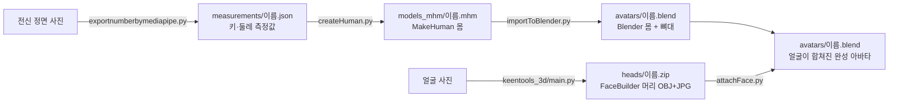

# clover

사람 사진으로 체형과 얼굴이 닮은 3D 아바타를 만드는 프로젝트입니다.
몸은 MakeHuman으로, 얼굴은 KeenTools FaceBuilder로 만들고, Blender에서 하나로 합칩니다.

## 전체 흐름



`python exportnumberbymediapipe.py 사진 --height 키` 한 번이면 위 단계가 **모두 자동으로** 이어서 실행됩니다.
측정이 끝나면 `pipeline.py`가 나머지 스크립트를 차례로 부릅니다.

| 단계 | 자동으로 실행되는 파일 | 넣는 것 | 만들어지는 것 |
| --- | --- | --- | --- |
| 1. 몸 치수 재기 | `create_avatar/exportnumberbymediapipe.py` | 전신 정면 사진, 실제 키 | `measurements/<이름>.json` (키, 가슴·허리·엉덩이·허벅지 둘레)<br/>`measurements/<이름>_viz.jpg` (측정선 확인용) |
| 2. 몸 만들기 | `create_avatar/createHuman.py` | 1단계 JSON, 성별·나이·근육 | `models_mhm/<이름>.mhm` (치수에 맞춘 MakeHuman 몸) |
| 3. 얼굴 만들기 | `keentools_3d/main.py` | 얼굴 사진 (최대 15장) | `heads/<이름>.zip` (머리 OBJ + 얼굴 텍스처 JPG). 이미 있으면 건너뜀 |
| 4. 몸 불러오기 | `create_avatar/importToBlender.py` (Blender 백그라운드) | 2단계 .mhm | `avatars/<이름>.blend` (키를 맞춘 몸 + 뼈대) |
| 5. 얼굴 합치기 | `create_avatar/attachFace.py` (Blender 백그라운드) | 4단계 .blend, 3단계 zip | `avatars/<이름>.blend` (얼굴이 합쳐진 완성 아바타)<br/>`avatars/<이름>_face.png` (몸 UV로 옮긴 얼굴 텍스처) |

사람마다 같은 **이름**(사진 파일 이름)을 쓰면 단계끼리 자동으로 짝지어집니다.
한 사람에서 어떤 단계가 실패하면 그 사람만 멈추고, 마지막에 사람별 결과(완료 / 부분 완료 / 실패)를 출력합니다.

## 처음 한 번만 준비

| 필요한 것 | 쓰는 단계 | 설치 |
| --- | --- | --- |
| Python 3.13 가상환경 + mediapipe | 1, 2, 3 | 아래 명령 (3단계 패키지도 같은 가상환경에 설치) |
| MakeHuman 소스 | 2 | `git clone --depth 1 https://github.com/makehumancommunity/makehuman.git C:\makehuman-src` (이 위치면 자동으로 찾음) |
| KeenTools API 키 | 3 | `keentools_3d/.env`에 `KEENTOOLS_API_KEY=...` (없으면 `heads/<이름>.zip`을 직접 준비하거나 `--skip-face`) |
| Blender 4.x 이상 + MPFB2 애드온 | 4, 5 | Blender의 Get Extensions에서 MPFB 설치. 기본 위치가 아니면 `$env:BLENDER = "...\blender.exe"` |

```powershell
cd create_avatar
py -3.13 -m venv .venv313
.venv313\Scripts\activate
pip install opencv-python mediapipe numpy PyQt5 PyOpenGL
# MakeHuman 소스를 C:\makehuman-src 가 아닌 곳에 받았다면 위치를 알려 줌 (makehuman.py가 있는 폴더)
# $env:MAKEHUMAN_SRC = "D:\내폴더\makehuman-src\makehuman"

cd ..\keentools_3d
pip install -r requirements.txt
```

## 한 번에 실행 (권장)

`create_avatar` 폴더에서 실행합니다.

```powershell
cd create_avatar
.venv313\Scripts\activate
python exportnumberbymediapipe.py testdata\sample_person.jpg --height 172 --gender male
```

- 결과: `measurements\sample_person.json` → `models_mhm\sample_person.mhm` → `avatars\sample_person.blend` (얼굴까지 합쳐진 완성본)
- `--height`에는 그 사람의 실제 키(cm)를 넣습니다. 빼면 175cm로 계산되어 모든 둘레가 틀어집니다.
- 얼굴은 다음 순서로 준비됩니다.
    1. `create_avatar\heads\sample_person.zip`(또는 `.obj`)이 있으면 그것을 씁니다.
    2. 없으면 `keentools_3d\input_images`의 얼굴 사진을 KeenTools로 보내 `heads\sample_person.zip`을 만듭니다 (API 키 필요).
    3. 둘 다 안 되면 경고를 내고 얼굴 없이 `avatars\sample_person.blend`까지만 만듭니다.
- Blender는 `--blender` 경로 → 환경변수 `BLENDER` → PATH의 `blender` → `C:\Program Files\Blender Foundation\Blender*` 순서로 찾습니다. 못 찾으면 `.mhm`까지만 만들고 멈춥니다.

### 옵션

| 옵션 | 뜻 | 기본값 |
| --- | --- | --- |
| `--height` | 실제 키(cm) | 175 |
| `--gender male\|female`, `--age`, `--muscle 0~1` | 2단계 몸 만들기 설정 | male, 25, 0.5 |
| `--mh-src` | MakeHuman 소스의 `makehuman` 폴더 (클론 폴더를 줘도 됨) | 환경변수 `MAKEHUMAN_SRC`, 없으면 자동 탐색 |
| `--blender` | blender 실행 파일 경로 | 자동 탐색 |
| `--heads-dir` | `<이름>.zip` 머리 파일 폴더 | `create_avatar\heads` |
| `--face-images` | 머리가 없을 때 KeenTools에 보낼 얼굴 사진 폴더 | `keentools_3d\input_images` |
| `--skip-face` | 얼굴 단계(3·5)를 빼고 몸만 | |
| `--measure-only` | 1단계(측정)만 | |
| `--out-dir` | 측정 결과 폴더 | `measurements` |

### 여러 명을 한 번에

사진 폴더를 주면 안의 사진을 모두 처리합니다. 이때 모든 사진에 같은 키·성별이 적용되니, 키나 성별이 다른 사람은 따로 실행하세요.

```powershell
python exportnumberbymediapipe.py testdata --height 172 --gender female
```

얼굴 사진은 사람별 하위 폴더에 넣습니다: `keentools_3d\input_images\<이름>\*.jpg`
(한 명만 처리할 때는 `input_images`에 바로 넣어도 됩니다.) 머리 zip을 직접 준비했다면 `heads\<이름>.zip`으로 두면 됩니다.

### 확인할 것

- `measurements\<이름>_viz.jpg`에서 색깔 선이 몸 윤곽 양 끝에 닿는지 확인하세요.
- 2단계 콘솔에 "경고"가 나온 부위는 대개 1단계 측정이 잘못된 것입니다.
- 5단계 콘솔의 "정렬: 얼굴 표면 평균 거리"가 1cm를 넘으면 경고가 나옵니다. 결과를 Blender에서 열어 확인하세요.
- 촬영 팁: 머리부터 발끝까지 보이는 정면, 팔은 몸에서 살짝 떼고, 몸에 붙는 옷. 얼굴 사진은 정면 외에 옆모습·30° 사진을 함께 넣으면 코 높이와 턱 깊이가 더 정확해집니다.

### 자주 나오는 오류

| 메시지 | 해결 |
| --- | --- |
| `MakeHuman 소스를 찾지 못했습니다` / `MakeHuman 소스 폴더가 아닙니다` | MakeHuman 소스를 받지 않았거나 위치를 못 찾은 것입니다. `git clone --depth 1 https://github.com/makehumancommunity/makehuman.git C:\makehuman-src`로 받으면 자동으로 찾습니다. 다른 곳에 받았다면 `$env:MAKEHUMAN_SRC = "<클론 경로>\makehuman"` 또는 `--mh-src <클론 경로>`를 주세요. 측정 결과는 저장돼 있으니 준비 후 같은 명령을 다시 실행하면 됩니다. |
| `Blender를 찾지 못했습니다` | `.mhm`까지만 만들어집니다. `--blender "C:\Program Files\Blender Foundation\Blender 4.2\blender.exe"`처럼 경로를 주거나 `$env:BLENDER`를 설정하세요. |
| `MPFB2가 설치돼 있지 않습니다` / `MPFB2가 설치돼 있지만 켜지지 않았습니다` / `MPFB2가 없고 <이름>.fbx 도 찾지 못했습니다` | 파이프라인은 Blender 단계 전에 MPFB2를 확인하고, 없으면 `.mhm`까지만 만들고 4·5단계를 건너뜁니다. Blender에서 **Edit > Preferences > Get Extensions**(처음이면 Allow Online Access 켜기) → `MPFB` 검색 → Install. 인터넷 없이 설치하려면 https://extensions.blender.org/add-ons/mpfb/ 에서 zip을 받아 Get Extensions 오른쪽 위 메뉴의 **Install from Disk...**. 설치 후 **Add-ons**에서 MPFB가 켜져 있는지, `--blender`로 실행하는 것과 같은 버전의 Blender에 설치했는지 확인하세요. |
| `KeenTools API 키가 없습니다` / `얼굴 사진이 없습니다` | 얼굴 합치기만 건너뛰고 몸은 끝까지 만듭니다. 키는 `keentools_3d\.env`에 `KEENTOOLS_API_KEY=발급받은키` 한 줄, 또는 `$env:KEENTOOLS_API_KEY = "발급받은키"`. 얼굴 사진은 `keentools_3d\input_images`에 넣습니다. 머리 zip이 이미 있으면 `create_avatar\heads\<이름>.zip`으로 두면 키 없이도 됩니다. |

자동 탐색 위치: `C:\makehuman-src`, `C:\makehuman`, `~\makehuman-src`, `~\makehuman`, 그리고 clover 폴더 안과 그 옆의 `makehuman-src` / `makehuman` (각각 그 안의 `makehuman\makehuman.py`까지 확인).

## 단계별로 따로 실행

한 단계만 다시 돌리고 싶을 때 씁니다. 1·2·4·5단계는 `create_avatar` 폴더에서 실행합니다.

### 1. 몸 치수 재기

```powershell
python exportnumberbymediapipe.py testdata\sample_person.jpg --height 172 --measure-only
```

- 결과: `measurements\sample_person.json`, `measurements\sample_person_viz.jpg`

### 2. 몸 만들기

```powershell
python createHuman.py measurements\sample_person.json --gender male
```

- 결과: `models_mhm\sample_person.mhm` (어느 폴더에서 실행해도 `create_avatar\models_mhm`에 모입니다. 바꾸려면 `--out-dir`)
- MakeHuman 메시에 모디파이어를 직접 적용하면서 키, 체중, 둘레가 측정값과 맞을 때까지 조정합니다.

### 3. 얼굴 만들기

```powershell
cd ..\keentools_3d
python main.py --images input_images --out ..\create_avatar\heads\sample_person.zip
```

- 결과: `create_avatar\heads\sample_person.zip` (머리 OBJ + 텍스처 JPG)
- 옵션 없이 `python main.py`로 실행하면 예전처럼 `keentools_head.zip`으로 저장되니, `heads\<이름>.zip`으로 이름을 바꿔 옮기세요.

### 4. 몸 불러오기

```powershell
blender --background --python importToBlender.py -- models_mhm --out avatars
```

- 결과: `avatars\<이름>.blend` (`models_mhm`의 .mhm 전부. 하나만 하려면 `models_mhm\sample_person.mhm`)
- MPFB2로 .mhm을 읽어 몸과 기본 뼈대를 만들고, 1단계의 실제 키에 맞춥니다.
- MPFB2가 없으면 같은 이름의 `.fbx`(MakeHuman에서 내보낸 파일)를 대신 불러옵니다.
- `blender`가 명령으로 안 잡히면 `"C:\Program Files\Blender Foundation\Blender 4.x\blender.exe"`처럼 전체 경로를 씁니다.

### 5. 얼굴 합치기

```powershell
blender --background --python attachFace.py -- avatars --heads heads --out avatars
```

- 결과: `avatars\<이름>.blend` (덮어씀), `avatars\<이름>_face.png`
- 안에서 일어나는 일:
    1. FaceBuilder 머리를 MakeHuman 머리 위치·회전·크기에 자동으로 맞춥니다. 머리 OBJ가 어느 방향으로 저장돼 있어도 됩니다.
    2. 얼굴 정점을 FaceBuilder 표면에 붙여 `FaceFit` 셰이프키로 저장합니다. 목·귀·뒷머리는 MakeHuman 그대로 두고 경계는 부드럽게 섞습니다.
    3. MPFB2로 눈, 눈썹, 속눈썹, 뼈대를 새 얼굴에 다시 맞춥니다.
    4. 얼굴 텍스처를 몸 UV로 베이크해 피부와 섞습니다.
- Blender에서 `FaceFit` 셰이프키 값을 0~1로 바꾸면 얼굴이 닮은 정도를 조절할 수 있습니다. FaceBuilder 머리는 `<이름>.facebuilder`라는 이름으로 숨겨져 있습니다.

## 폴더 구조

```
create_avatar/
  exportnumberbymediapipe.py   1단계: 사진 -> 치수 JSON (이어서 pipeline.py로 2~5단계 자동 실행)
  pipeline.py                  2~5단계를 차례로 실행하는 파이프라인
  createHuman.py               2단계: JSON -> .mhm
  importToBlender.py           4단계: .mhm -> .blend
  attachFace.py                5단계: .blend + 머리 zip -> 완성 아바타
  data/face_fit_hm08.json      5단계가 쓰는 얼굴 가중치·기준점 (tools/makeFaceFitData.py로 생성)
  models/                      mediapipe 포즈 모델
  testdata/                    예시 사진
  measurements/                1단계 결과 (JSON, _viz.jpg)
  models_mhm/                  2단계 결과 (.mhm 아바타 모델)
  avatars/                     4·5단계 결과 (.blend, _face.png)
  heads/                       3단계 결과, 사람별 <이름>.zip (git에 올리지 않음)
keentools_3d/
  main.py                      3단계: 얼굴 사진 -> 머리 zip (--images, --out)
  input_images/                얼굴 사진 (한 명이면 바로, 여러 명이면 <이름>/ 하위 폴더)
garmentcode-product-image-adapter/
                               옷 제품 사진 -> GarmentCode 패턴 (아바타 파이프라인과 별개, 자체 README 참고)
```
