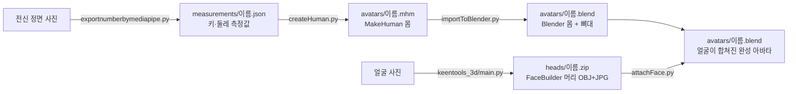

# clover

사람 사진으로 체형과 얼굴이 닮은 3D 아바타를 만드는 프로젝트입니다.
몸은 MakeHuman으로, 얼굴은 KeenTools FaceBuilder로 만들고, Blender에서 하나로 합칩니다.

## 전체 흐름



| 단계 | 실행할 파일 | 넣는 것 | 만들어지는 것 |
| --- | --- | --- | --- |
| 1. 몸 치수 재기 | `create_avatar/exportnumberbymediapipe.py` | 전신 정면 사진, 실제 키 | `measurements/<이름>.json` (키, 가슴·허리·엉덩이·허벅지 둘레)<br/>`measurements/<이름>_viz.jpg` (측정선 확인용) |
| 2. 몸 만들기 | `create_avatar/createHuman.py` | 1단계 JSON, 성별·나이·근육 | `avatars/<이름>.mhm` (치수에 맞춘 MakeHuman 몸) |
| 3. 얼굴 만들기 | `keentools_3d/main.py` | 얼굴 사진 (최대 15장) | `keentools_head.zip` (머리 OBJ + 얼굴 텍스처 JPG) |
| 4. 몸 불러오기 | `create_avatar/importToBlender.py` (Blender에서 실행) | 2단계 .mhm | `avatars/<이름>.blend` (키를 맞춘 몸 + 뼈대) |
| 5. 얼굴 합치기 | `create_avatar/attachFace.py` (Blender에서 실행) | 4단계 .blend, 3단계 zip | `avatars/<이름>.blend` (얼굴이 합쳐진 완성 아바타)<br/>`avatars/<이름>_face.png` (몸 UV로 옮긴 얼굴 텍스처) |

3단계는 1~2단계와 따로 진행할 수 있습니다. 4·5단계는 Blender 안에서 실행됩니다.
사람마다 같은 **이름**(사진 파일 이름)을 쓰면 단계끼리 자동으로 짝지어집니다.

## 처음 한 번만 준비

| 필요한 것 | 쓰는 단계 | 설치 |
| --- | --- | --- |
| Python 3.13 가상환경 + mediapipe | 1, 2 | 아래 명령 |
| MakeHuman 소스 | 2 | `git clone --depth 1 https://github.com/makehumancommunity/makehuman.git C:\makehuman-src` |
| KeenTools API 키 | 3 | `keentools_3d/.env`에 `KEENTOOLS_API_KEY=...` |
| Blender 4.x 이상 + MPFB2 애드온 | 4, 5 | Blender의 Get Extensions에서 MPFB 설치 |

```powershell
cd create_avatar
py -3.13 -m venv .venv313
.venv313\Scripts\activate
pip install opencv-python mediapipe numpy PyQt5 PyOpenGL
$env:MAKEHUMAN_SRC = "C:\makehuman-src\makehuman"   # createHuman.py가 MakeHuman 소스를 찾는 곳

cd ..\keentools_3d
pip install -r requirements.txt
```

## 단계별 실행

아래 예시는 `sample_person.jpg` 한 명 기준입니다. 1·2·4·5단계는 `create_avatar` 폴더에서 실행합니다.

### 1. 몸 치수 재기

```powershell
python exportnumberbymediapipe.py testdata\sample_person.jpg --height 172
```

- 결과: `measurements\sample_person.json`, `measurements\sample_person_viz.jpg`
- `--height`에는 그 사람의 실제 키(cm)를 넣습니다. 빼면 175cm로 계산되어 모든 둘레가 틀어집니다.
- `_viz.jpg`에서 색깔 선이 몸 윤곽 양 끝에 닿는지 확인하세요.
- 폴더를 주면 안의 사진을 모두 처리합니다 (`python exportnumberbymediapipe.py testdata --height 172`). 이때 모든 사진에 같은 키가 적용됩니다.
- 촬영 팁: 머리부터 발끝까지 보이는 정면, 팔은 몸에서 살짝 떼고, 몸에 붙는 옷.

### 2. 몸 만들기

```powershell
python createHuman.py measurements\sample_person.json --gender male
```

- 결과: `avatars\sample_person.mhm`
- MakeHuman 메시에 모디파이어를 직접 적용하면서 키, 체중, 둘레가 측정값과 맞을 때까지 조정합니다.
- 옵션: `--gender male|female`, `--age 나이`(기본 25), `--muscle 0~1`(기본 0.5)
- 콘솔에 "경고"가 나온 부위는 대개 1단계 측정이 잘못된 것이니 `_viz.jpg`를 다시 확인하세요.

### 3. 얼굴 만들기

```powershell
cd ..\keentools_3d
# input_images 폴더에 얼굴 사진을 넣고
python main.py
```

- 결과: `keentools_3d\keentools_head.zip` (머리 OBJ + 텍스처 JPG)
- 이 파일을 `create_avatar\heads\sample_person.zip`으로 **이름을 바꿔 옮겨** 주세요. 5단계가 이 이름으로 몸과 짝을 찾습니다.
- 정면 외에 옆모습·30° 사진을 함께 넣으면 코 높이와 턱 깊이가 더 정확해집니다. 사진은 무표정으로, 고르게 비춘 빛에서 찍는 것이 좋습니다.

### 4. 몸 불러오기

```powershell
blender --background --python importToBlender.py -- avatars --out avatars
```

- 결과: `avatars\sample_person.blend`
- MPFB2로 .mhm을 읽어 몸과 기본 뼈대를 만들고, 1단계의 실제 키에 맞춥니다.
- MPFB2가 없으면 같은 이름의 `.fbx`(MakeHuman에서 내보낸 파일)를 대신 불러옵니다.
- `blender`가 명령으로 안 잡히면 `"C:\Program Files\Blender Foundation\Blender 4.x\blender.exe"`처럼 전체 경로를 씁니다.

### 5. 얼굴 합치기

```powershell
blender --background --python attachFace.py -- avatars --heads heads --out avatars
```

- 결과: `avatars\sample_person.blend` (덮어씀), `avatars\sample_person_face.png`
- 안에서 일어나는 일:
    1. FaceBuilder 머리를 MakeHuman 머리 위치·회전·크기에 자동으로 맞춥니다. 머리 OBJ가 어느 방향으로 저장돼 있어도 됩니다.
    2. 얼굴 정점을 FaceBuilder 표면에 붙여 `FaceFit` 셰이프키로 저장합니다. 목·귀·뒷머리는 MakeHuman 그대로 두고 경계는 부드럽게 섞습니다.
    3. MPFB2로 눈, 눈썹, 속눈썹, 뼈대를 새 얼굴에 다시 맞춥니다.
    4. 얼굴 텍스처를 몸 UV로 베이크해 피부와 섞습니다.
- 콘솔의 "정렬: 얼굴 표면 평균 거리"가 1cm를 넘으면 경고가 나옵니다. 그때는 결과를 Blender에서 열어 확인하세요.
- Blender에서 `FaceFit` 셰이프키 값을 0~1로 바꾸면 얼굴이 닮은 정도를 조절할 수 있습니다. FaceBuilder 머리는 `<이름>.facebuilder`라는 이름으로 숨겨져 있습니다.

## 여러 명을 한 번에

이름만 맞춰 두면 폴더 단위로 돌릴 수 있습니다.

```powershell
python exportnumberbymediapipe.py testdata --height 172 --out-dir measurements
Get-ChildItem measurements\*.json | ForEach-Object { python createHuman.py $_.FullName --gender female }
# heads 폴더에 사람마다 <이름>.zip 준비
blender --background --python importToBlender.py -- avatars --out avatars
blender --background --python attachFace.py -- avatars --heads heads --out avatars
```

## 폴더 구조

```
create_avatar/
  exportnumberbymediapipe.py   1단계: 사진 -> 치수 JSON
  createHuman.py               2단계: JSON -> .mhm
  importToBlender.py           4단계: .mhm -> .blend
  attachFace.py                5단계: .blend + 머리 zip -> 완성 아바타
  data/face_fit_hm08.json      5단계가 쓰는 얼굴 가중치·기준점 (tools/makeFaceFitData.py로 생성)
  models/                      mediapipe 포즈 모델
  testdata/                    예시 사진
  measurements/                1단계 결과
  avatars/                     2·4·5단계 결과
  heads/                       3단계 결과를 이름별로 모아 두는 곳 (git에 올리지 않음)
keentools_3d/
  main.py                      3단계: 얼굴 사진 -> 머리 zip
garmentcode-product-image-adapter/
                               옷 제품 사진 -> GarmentCode 패턴 (아바타 파이프라인과 별개, 자체 README 참고)
```
